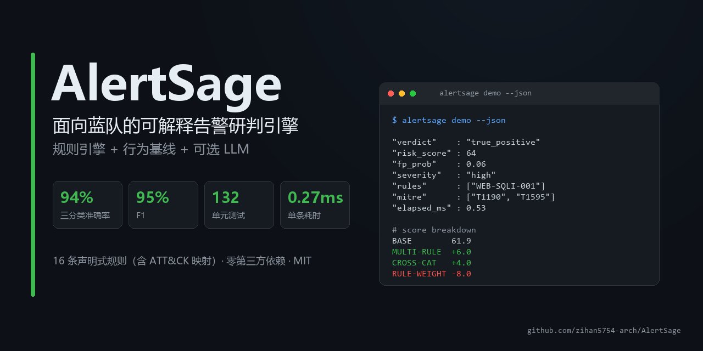
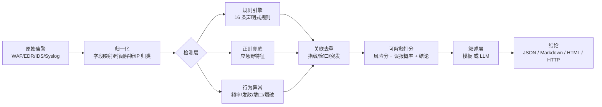

# AlertSage



> 面向蓝队的**可解释**告警研判引擎：把"这条告警要不要管"从人的经验，变成可复现、可评估、可解释的流水线。

[](https://github.com/zihan5754-arch/AlertSage/actions/workflows/ci.yml)


---

## 它解决什么问题

护网现场的真实矛盾不是"没有告警"，而是**告警太多、能干活的人太少**：

- 一台 WAF 一天几万条，90% 是扫描器、爬虫、拨测、被拦截的攻击尝试；
- 每条都要人点开、看 payload、查 IP、写结论，一条 3~5 分钟；
- 真正有价值的信号被埋在噪音里，值班同学到后半夜基本处于"机械关单"状态。

AlertSage 做的是**第一道分诊**：对每条告警输出

| 输出 | 含义 |
| --- | --- |
| `verdict` | 真实攻击 / 疑似误报 / 待人工复核 |
| `risk_score` | 0~100 的风险分，决定处置优先级 |
| `fp_probability` | 误报概率，和风险分是两个维度 |
| `evidence` | 每一条加减分的依据（可追溯到规则、行为、资产） |
| `recommendations` | 具体处置动作，不是"建议关注"这种废话 |

关键点：**AI 不参与判决**。判定由确定性引擎完成，LLM 只负责把结论翻译成人话。这样结论可复现、可审计，模型抽风也不会把误报说成入侵。

---

## 30 秒跑起来

```bash
git clone https://github.com/zihan5754-arch/AlertSage.git
cd AlertSage
python -m alertsage demo        # 不需要装任何第三方依赖
```

输出（真实终端输出，非示意）：

```
  真实攻击  风险  64/100  [█████████████·······]
  攻击类型 : SQL 注入 - 布尔/联合永真式
  严重度   : high    误报概率 6%    置信度 99%
  关联     : INC-0001-d26cad（1 次）
  检测器   : WEB-SQLI-001, NET-SCAN-001, REGEX-SCANNER
  ATT&CK   : T1190, T1595

  分数构成：
    BASE           WEB-SQLI-001 严重度=high 置信度=0.86          +0  → 61.9
    MULTI-RULE     另有 1 条规则独立命中                           +6  → 67.9
    CROSS-CATEGORY 跨类别交叉证据 ['recon', 'web']                +4  → 71.9
    RULE-WEIGHT    规则权重合计 -8                                -8  → 63.9
```

批量研判 + 生成报告：

```bash
python -m alertsage triage -f data/samples/alerts.jsonl -o reports/report.html
python -m alertsage evaluate            # 在带标签的数据集上算准确率
python -m alertsage serve --port 8000   # HTTP 服务（零依赖版）
```

报告样例：[`docs/sample-report.html`](docs/sample-report.html)（浏览器直接打开，含 Top 风险清单和证据链）。

需要 `/docs` 交互式文档时：

```bash
pip install -r requirements-api.txt
python -m alertsage serve --port 8000 --fastapi
# 或兼容 v0.1 的启动方式：
uvicorn app.main:app --reload
```

---

## 架构



一次研判的完整数据流，每一步都能单独测试、单独替换：

```
normalize → detect → correlate → score → narrate → TriageResult
```

---

## 评估结果

数据集：`data/samples/labeled.jsonl`，183 条**合成**样本（115 真实攻击 / 46 误报 / 22 待复核），按时间顺序回放。

| 指标 | 数值 |
| --- | ---: |
| 三分类准确率 | **93.99%** |
| 自动定性率（无需人工介入） | **84.70%** |
| 真实攻击 查准 / 查全 / F1 | **95.61% / 94.78% / 95.19%** |
| 误报漏放率（误报被当成攻击） | **10.87%** |
| 单条耗时 p50 / p95 | **0.27 ms / 0.38 ms** |

混淆矩阵（行=人工标签，列=系统结论）：

| 标签 \ 结论 | true_positive | false_positive | needs_review |
| --- | ---: | ---: | ---: |
| true_positive | 109 | 0 | 6 |
| false_positive | 5 | 41 | 0 |
| needs_review | 0 | 0 | 22 |

> **必须说清楚**：这是合成数据，指标偏乐观，只能用于版本间回归对比，不能当作真实护网准确率。
> 真实环境要拿客户脱敏告警重新标注，通常准确率会掉 10~20 个点。
> 已知的两类错误都写在下文「能力边界」里，没有藏。

---

## 核心设计决策

### 1. 规则是数据，不是代码

v0.1 把正则写死在 `ATTACK_PATTERNS` 列表里。问题是：加一条规则要改 Python、发版、重启，安全同学干不了。

现在规则是 JSON：

```json
{
  "id": "WEB-SQLI-002",
  "title": "SQL 注入 - 时间盲注",
  "severity": "critical",
  "confidence": 0.9,
  "mitre": ["T1190"],
  "match": {"any": [
    {"text": "regex:(?i)(sleep|benchmark|pg_sleep)\\s*\\(\\s*\\d+"}
  ]},
  "recommendations": ["立即确认该接口是否可注入", "封禁来源 IP"]
}
```

支持 `all / any / not` 组合和 `regex / contains / contains_any / equals / in / startswith / endswith / gt / lt / exists` 操作符，`alertsage rules --lint` 会检查 id 唯一性、MITRE 映射、处置建议完整性。

### 2. 风险分和误报概率必须分开

很多工具输出一个"置信度"，但这两个问题完全不同：

- "这是不是攻击？" → `fp_probability`
- "要不要现在处理？" → `risk_score`

被 WAF 拦下的 Log4j 利用，是**真实攻击**（fp 低），但**紧迫度低**（agent 已拦截）。反过来，内网扫描器打内网，可能是**误报**（fp 高），但如果是横向移动的前奏就**很急**。合成一个分数必然做错决策。

### 3. 每个加减分都要留痕

```python
ledger.scale(0.85, "ACTION", "WAF/IPS 已拦截，实际危害与紧迫度下降", extra=-4)
```

`TriageResult.meta["score_breakdown"]` 会原样输出这条链：从 61.9 分怎么走到 63.9 分，每一步多少、为什么。值班同学不同意某一步，能直接指出来改阈值，而不是"这 AI 说不清"。

### 4. LLM 只解释，不判决

```
确定性引擎 → 结论(verdict/risk/evidence) → LLM 写分析 → 校验 → 失败则回退模板
```

校验规则（`alertsage/llm/reporter.py`）：

- 输出必须是合法 JSON，`analysis` 非空且 < 2000 字；
- 文中引用的规则编号必须真实存在于证据链里 → 编造 `WEB-FAKE-999` 直接判失败；
- 任何异常（超时、限流、乱码）都降级到模板叙述，`degraded=true`，研判流程不受影响。

所以**没有 API Key 也能完整跑通**——这是刻意设计，不是没做完。

### 5. 零第三方依赖的核心

核心引擎只用标准库。原因是真实的：甲方跳板机、隔离网、容器镜像里经常装不了包。HTTP 层做成可选（`fastapi`），演示/离线用标准库 `http.server` 也能跑。

---

## 规则编写

```bash
python -m alertsage rules              # 列出全部规则
python -m alertsage rules --lint       # 检查规则完整性（CI 里会跑）
```

| 字段 | 说明 |
| --- | --- |
| `id` | 唯一编号，建议 `类别-技术-序号` |
| `severity` | info/low/medium/high/critical，决定基础分 |
| `confidence` | 0~1，规则本身的确定性 |
| `mitre` | ATT&CK 技术编号，用于覆盖度统计和报告 |
| `match` | 条件树，见上文 DSL |
| `weight_delta` | 规则级分数微调（例如扫描类 -6） |
| `recommendations` | 处置建议，会合并进最终输出 |

新增规则：在 `alertsage/rules/` 下加 JSON，重启即生效，不用改任何 Python。

---

## 配置

全部通过环境变量，前缀 `ALERTSAGE_`：

| 变量 | 默认 | 说明 |
| --- | --- | --- |
| `TP_THRESHOLD` | 45 | 风险分 ≥ 此值判为真实攻击 |
| `FP_THRESHOLD` | 22 | 风险分 ≤ 此值且误报概率高则判误报 |
| `CORRELATE_WINDOW` | 600 | 关联窗口（秒） |
| `BURST_THRESHOLD` | 8 | 窗口内同指纹达到多少次判定为突发 |
| `RATE_WINDOW` | 300 | 行为基线滑动窗口（秒） |
| `ALLOWLIST` | 空 | 来源 IP 白名单，逗号分隔正则 |
| `ASSETS` | `{}` | 资产重要度 JSON，如 `{"pay-api":1.2,"test-*":0.7}` |
| `LLM_ENABLED` | false | 是否启用 LLM 叙述层 |
| `LLM_PROVIDER` | mock | `mock`（离线模板）/ `openai`（任何 OpenAI 兼容接口） |
| `LLM_BASE_URL` | api.openai.com/v1 | 也可指向 DeepSeek / 通义 / vLLM / Ollama |
| `LLM_MODEL` | gpt-4o-mini | 模型名 |
| `LLM_API_KEY` | 空 | API Key |
| `LLM_MIN_RISK` | 40 | 风险低于此值不调用模型（省 token） |

例：

```bash
ALERTSAGE_LLM_ENABLED=true \
ALERTSAGE_LLM_PROVIDER=openai \
ALERTSAGE_LLM_BASE_URL=https://api.deepseek.com/v1 \
ALERTSAGE_LLM_MODEL=deepseek-chat \
ALERTSAGE_LLM_API_KEY=sk-xxx \
python -m alertsage demo
```

---

## HTTP 接口

| 方法 | 路径 | 说明 |
| --- | --- | --- |
| GET | `/health` | 健康检查、规则数、LLM 状态 |
| GET | `/rules` | 规则清单 |
| POST | `/triage` | 单条研判 |
| POST | `/triage/batch` | 批量研判 + 汇总 |

```bash
curl -X POST http://127.0.0.1:8000/triage \
  -H 'Content-Type: application/json' \
  -d '{"alert_type":"SQL Injection","src_ip":"45.134.26.17","payload":"1 union select 1,2"}'
```

---

## 能力边界（面试也会问，先写清楚）

| 问题 | 现状 | 原因 / 计划 |
| --- | --- | --- |
| 搜索框输入 "union select" 会被判成注入 | 5/183 误报漏放 | 纯文本匹配的固有缺陷；计划引入 SQL 语法结构解析 + 上下文（参数名/响应码/前后请求） |
| DNS 隧道等规则未覆盖的攻击 | 6/183 只到 `needs_review` | 这是**预期行为**：没证据就交给人，绝不自动关闭。规则库持续补 |
| 行为基线只在单进程内存里 | 适合单机/单实例 | 多实例部署要把状态换 Redis，接口已预留 `snapshot()` |
| 合成数据指标偏乐观 | 已知 | 需要真实脱敏数据重标注 |
| 没有前端界面 | 输出 HTML 报告 | 刻意不做大屏，先把研判质量做扎实 |

---

## 目录结构

```
alertsage/
  models.py          数据模型（Alert/Detection/Evidence/TriageResult）
  normalize.py       多源归一化（Wazuh/Elastic/Suricata/通用）
  rules.py           规则加载、校验、条件 DSL 求值
  rules/*.json       规则库（16 条，覆盖 Web/网络/主机）
  detectors/         检测器：规则引擎、正则兜底、行为异常
  correlate.py       指纹去重、窗口关联、突发识别
  scoring.py         可解释打分（分数账本）
  llm/               Provider 抽象、Mock、OpenAI 兼容、校验降级
  pipeline.py        编排 + 批量 + 统计
  evaluate.py        评估（混淆矩阵/P-R-F1/分类型召回）
  report.py          Markdown / HTML 报告
  api/               标准库 HTTP 服务 + FastAPI 应用
  cli.py             命令行入口
app/main.py          兼容 v0.1 的 uvicorn 启动方式
tests/               132 个单元测试 + 接口测试
scripts/             数据集生成
docs/                设计说明、面试讲稿、v0.1 诊断书
```

---

## 开发

```bash
python -m unittest discover -s tests -t .   # 132 个测试
python -m alertsage rules --lint            # 规则检查
python -m alertsage evaluate                # 回归指标
python scripts/gen_dataset.py               # 重新生成合成数据集（固定 seed）
```

CI（GitHub Actions）会跑：单元测试 × Python 3.10/3.11/3.12、规则 lint、评估指标不低于基线。

---

## 从 v0.1 到现在改了什么

v0.1 是 4 个文件、163 行，本质是"正则匹配器 + 一个 POST 接口"。详见 [docs/REVIEW.md](docs/REVIEW.md)。

| | v0.1 | v0.2 |
| --- | --- | --- |
| 检测 | 5 条写死正则 | 16 条声明式规则 + 行为异常 + 正则兜底 |
| 判定 | 命中即 `true_positive` | 风险分/误报概率/结论三维，阈值可配 |
| 解释 | 一句固定文案 | 证据链 + 分数构成 |
| 关联 | 无 | 指纹去重 + 窗口关联 + 突发识别 |
| LLM | README 里写"规划中" | 真实可插拔，含防幻觉校验与降级 |
| 数据源 | 自定义字段 | Wazuh / Elastic / Suricata / 通用映射 |
| 评估 | 无 | 183 条标注集 + 混淆矩阵 + 回归门槛 |
| 测试 | 0 | 132 |
| 部署 | 一条 uvicorn | uvicorn / 零依赖服务 / Docker / Compose |

---

## Roadmap

- [ ] 规则热加载 + 规则版本管理（改规则可回滚）
- [ ] 反馈闭环：人工复核结果回写，自动调规则 `confidence`
- [ ] 状态外置到 Redis，支持多实例
- [ ] SIGMA 规则导入（直接吃社区规则集）
- [ ] 简易前端：告警队列 + 一键采纳/驳回
- [ ] 真实脱敏数据集上的评估报告

## License

MIT
